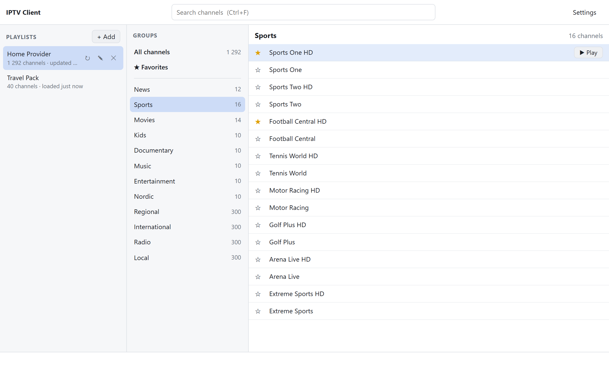

# IPTV Client

A desktop app for Windows and macOS that imports M3U/M3U8 IPTV playlists,
lets you browse them by group, search them, and opens channels in
[VLC](https://www.videolan.org) or another supported player.

Built with Go, [Wails](https://wails.io) (native window and system webview)
and SQLite.

<picture>
  <source media="(prefers-color-scheme: dark)" srcset="docs/screenshot-dark.png">
  
</picture>

> **Status:** core library, debug CLI and GUI are working on Windows; macOS
> builds are produced by CI but not yet verified on a Mac.

## Features

- Multiple playlists, from a URL or a local file
- Browse by `group-title`, full-text search, favorites
- Favorites survive playlist refreshes, even if the provider changes the
  credentials embedded in stream URLs
- Handles very large playlists (200k channels import in about 3 seconds)
- Plays in VLC (auto-detected) or a player chosen in Settings: mpv, IINA,
  MPC-HC or PotPlayer. VLC, mpv and IINA receive the channel name and any
  allowed `#EXTVLCOPT` headers (User-Agent, Referrer); MPC-HC and PotPlayer
  only get the stream URL. A running VLC is reused instead of opening a new
  window per channel
- Preferred audio languages in Settings, in order (e.g. `sv, en`; English by
  default): VLC, mpv and IINA pick the first language a channel has
- Right-click a channel (or press Ctrl+C / ⌘C) to copy its stream URL and
  paste it into any other player. Go writes the URL to the clipboard, so it
  never reaches the UI (provider URLs often contain credentials)
- Program guide (XMLTV/EPG, plain or `.gz`): what is on now in the channel
  list, and now/next with a description for the selected channel. The guide
  URL comes from the playlist's `url-tvg`/`x-tvg-url` header or is set with ✎
  on the playlist. It is loaded with the playlist and refreshed when older
  than 12 hours. Guide channels match on `tvg-id`, else on the name
- Channel logos from `tvg-logo` (or the guide's channel icon)
- On macOS, the app menu has About, Check for Updates… and Settings… (⌘,),
  and the Help menu links to GitHub and the log folder

## Security model

Playlists are untrusted input. Before anything reaches the player:

- Stream URLs must use `http`, `https`, `rtmp(s)`, `rtsp`, `rtp`, `udp` or
  `mms(h)` — no `file:`, no option-like values.
- Only `http-user-agent`, `http-referrer` and `network-caching` are taken
  from `#EXTVLCOPT`; options such as `sout` are dropped.
- The player is started directly (never through a shell), and its path must
  point to the executable of a supported player (`vlc`, `mpv`, `iina-cli`,
  `mpc-hc64.exe`, `PotPlayerMini64.exe`, ...); it can only be set through a
  native file dialog.

Program guides are untrusted input too: they are parsed as text (no
external entities), capped at 1 GB uncompressed, and only the programmes of
the playlist's channels for the next 48 hours are kept. Logos are downloaded
by Go (2 MB cap, PNG/JPEG/GIF/WebP/BMP/ICO only, no SVG), cached in a `logos`
folder next to the database and served to the UI at `/logo/<channel id>`: the
UI's CSP allows no remote images, and logo and guide URLs never reach it.
Logo hosts named by the playlist see your IP address when logos load.

Playlist and guide URLs are stored unencrypted in the local database.

Logs never contain stream, playlist, guide or logo URLs, `#EXTVLCOPT` options, the
User-Agent, or channel and playlist names: code logs IDs, and as a backstop
every logged value is redacted (URLs are cut to `scheme://host/…`, the home
folder becomes `~`). Provider host names are kept. Logs stay on this computer
(see [docs/SETUP.md](docs/SETUP.md#logs)).

## Layout

```
main.go, app.go        Wails entry point and GUI bindings
frontend/              UI (Vite + TypeScript, no framework)
frontend/e2e           UI tests and README screenshots against a stubbed backend
internal/playlist      playlists: add, import/refresh, rename, delete (service + repository)
internal/channel       channels: browse, search, favorites, play (service + repositories)
internal/epg           XMLTV program guide: streaming parser, import, now/next lookup
internal/logo          channel logo download and disk cache
internal/setting       settings: player location, audio languages, User-Agent, log level (service + repository)
internal/logging       slog setup, rotated log files, crash capture, Wails/UI log adapters
internal/redact        removes URLs' credentials and the home folder from logged text
internal/desktop       opens a folder in Explorer/Finder
internal/database      SQLite connection, migrations, transactions
internal/m3u           streaming playlist parser
internal/fetch         playlist download (size cap, ETag, credential-safe errors)
internal/player        player discovery and argument profiles, URL/option allowlists, launch
cmd/iptv-debug         developer CLI (not shipped)
docs/SETUP.md          developer setup — start here
```

## Getting started

See **[docs/SETUP.md](docs/SETUP.md)** for installing the toolchain, building,
testing and running unsigned builds.
